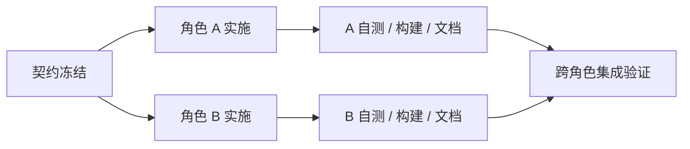
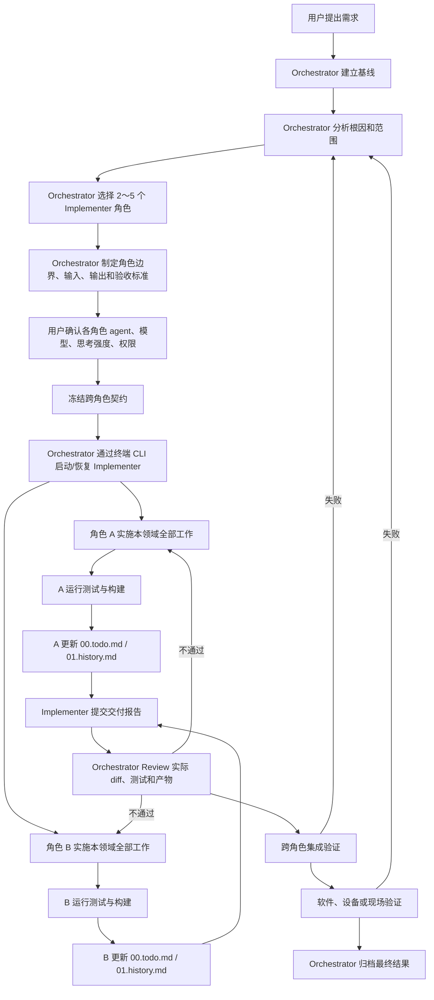

# Orchestrator–Implementer 多角色协同开发架构

> 适用范围：所有代码任务（嵌入式 MCU、上位机、算法、后端、数据库等）
> 核心思想：单一收口 + 领域分工 + 独立验证

## 1. 总体架构

本架构采用「Orchestrator 统一收口 + Implementer 按领域分工」的双层结构：

- **Orchestrator（编排者）**：负责理解需求、建立基线、分析根因、划分 2～5 个 Implementer 角色、制定计划、冻结跨角色接口、定义验收标准、审查实际改动并独立验证。
- **Implementer（实施者）**：按领域角色实施。每个角色负责其领域内从分析、编码、测试、构建到交接的完整工作，不再将同一领域拆成多个过细的执行角色。
- **终端 CLI（Implementer 运行时）**：Orchestrator 通过终端命令启动和继续 Implementer，并记录命令、工作目录、会话 ID、输出日志和退出码。
- **用户 / 领域专家**：负责提供真实环境信息，并完成现场、设备、业务和最终验收。

三条不可妥协的约束：

1. 所有代码任务必须经过完整闭环：**基线 → 角色划分 → 计划 → 契约确认 → 实施 → 角色文档更新 → Review → 跨角色集成 → 软件验证 → 现场验证 → 文档归档**（低风险单角色任务可走轻量通道，见 3.3）。
2. 任何角色的完成报告、软件测试通过或构建成功，都**不能替代**系统级验证和真实环境验收。
3. 每个角色在报告完成前，**必须**更新 `00.todo.md` 和 `01.history.md`，记录任务状态、修改文件、测试结果、构建产物、未完成项和经验教训。

## 2. 角色定义

### 2.1 Orchestrator

| 职责 | 说明 |
| --- | --- |
| 理解需求 | 将用户描述转化为可执行、可验收的任务定义 |
| 建立基线 | 记录任务开始前的提交号，作为 diff 与回溯的基准 |
| 分析根因与范围 | 定位问题根因，明确改动影响面，避免表面修复 |
| 划分角色 | 选择 2～5 个 Implementer 角色，并划定边界 |
| 制定计划 | 明确各角色的输入、输出、依赖顺序与验收标准 |
| 冻结跨角色接口 | 在实施前锁定协议、数据结构、命令等跨角色契约 |
| 审查实际改动 | Review 真实 diff、测试结果与构建产物，而非只看报告 |
| 独立验证 | 自行复现测试与集成验证，不依赖 Implementer 的自述 |
| 归档结果 | 汇总交付报告、验证记录与遗留项，完成最终归档 |

#### 独立性保证

Orchestrator 同时参与根因分析与计划制定，Review 时容易产生确认偏误。以下四条为硬性要求：

1. **先 diff 后报告**：Review 顺序固定为「读 diff → 跑验证 → 最后看交付报告」，避免被报告措辞锚定。
2. **至少一条自写命令**：独立验证不得完全复用 Implementer 的测试脚本，必须有一条 Orchestrator 自行编写的验证命令或观测手段。
3. **反向假设**：Review 结论中必须写明「如果这个改动是错的，最可能错在哪」，并针对该点做一次检查。
4. **高风险换人复核**：涉及安全、现场设备、不可回滚操作的改动，由未参与实施的实例或第二个角色复核。

### 2.2 Implementer

Implementer 按**完整业务领域**拆分。一个角色负责一个领域的全部相关工作，包括分析、实现、测试、构建和交接；只有跨领域的工作才单独设置角色。

| 角色 | 完整负责范围 |
| --- | --- |
| 领域实现角色 | 某一个核心业务领域的全部实现、测试和调试，例如 MCU、后端、算法或数据库 |
| 用户端角色 | 上位机、桌面端、Web 前端、移动端及其通信和交互逻辑 |

Implementer 默认由 Orchestrator 通过终端 CLI 启动和管理。Orchestrator 负责调用命令、工作目录、模型、模式、权限、会话 ID、输出日志、退出码和最终独立验证。

### 2.3 终端调用管理边界

| 能力 | 使用方式 | 必须留痕 |
| --- | --- | --- |
| 启动 Implementer | `opencode run -m <provider/model> --agent build --auto --title "<任务>" "<提示词>"` | 命令、cwd、模型、开始时间 |
| 继续会话 | `opencode run -s <session-id> ...` | session ID、追加任务 |
| 观察过程 | 终端 stdout/stderr、`opencode session list`、`opencode export <session-id>` | 关键工具调用、错误、最终报告 |
| 完成与异常 | 退出码、日志、`opencode -s <session-id>` | 退出码、原因、重试决定 |

硬性规则：

1. 默认使用终端 CLI 调用 Implementer，不把外部 agent 管理平台作为默认路径。
2. 调用前确认 cwd、agent、model、mode、thinking 和权限；记录可复现的完整命令。
3. `--auto` 只能在用户明确授权自动执行时使用；否则保留权限确认。
4. 必须保存 CLI session ID、stdout/stderr 日志和退出码；需要复盘时使用 `opencode session list`、`opencode export` 或 TUI。
5. CLI 退出成功、完成报告或 session 记录不能替代 Orchestrator 的 diff 审查、测试、构建和独立验证。
6. CLI 进程取消或异常时，按第 11.2 节检查退出码、日志、session export、git status 和真实 diff；禁止静默重试。
7. 长运行服务由 Orchestrator 在独立终端会话中管理，Implementer 只接收 URL；禁止在 Implementer 工具调用内用后台 shell 启动服务。
8. 文档和代码文件按第 11.1 节执行 UTF-8 编码规范。

### 2.4 用户 / 领域专家

- 提供真实环境信息（设备状态、现场条件、业务规则）；
- 决定各角色使用的 agent、模型、思考强度与权限；
- 完成现场验证、设备验证、业务验证和最终验收；
- 对 Orchestrator 无法在软件层确认的结论作出判定。

### 2.5 统一 CLI Supervisor 事件桥

Orchestrator 不再连续轮询 Implementer 的完整输出。所有本地 CLI 默认经 `02.Multi-AI/cli_supervisor.py` 托管；Supervisor 把 provider 输出归一化为版本化 JSONL 事件，只在 action 事件发生时唤醒 Orchestrator。

| 能力 | 统一入口 | 记录 |
| --- | --- | --- |
| 启动/恢复 OpenCode | `cli_supervisor.py --provider opencode` | event/status/raw 日志、PID、session ID |
| 启动/恢复 CodeBuddy | `cli_supervisor.py --provider codebuddy` | 同上 |
| 测试或本地 fixture | `cli_supervisor.py --provider generic` | 同上 |
| 查看普通进度 | event log 中的 `progress` | 默认不打印到 Supervisor stdout |
| 等待审批/输入 | `approval_required`、`waiting_input` | 同时更新状态文件 |
| 暂停 | 控制命令 `pause` | 发送中断信号后发布 `paused` |
| 异常退出 | `failed`、`canceled` | 保留退出码和原始日志 |
| 无输出失联 | `heartbeat_timeout` | 仅在超过阈值且进程仍存活时发布 |

#### 2.5.1 输出与状态文件

每次运行必须使用三个独立路径：

```text
<run>.events.jsonl   归一化事件流，UTF-8 JSONL，一行一个事件
<run>.status.json    原子更新的当前状态，供快速读取
<run>.raw.log        provider stdout/stderr 原始日志，不提交仓库
```

事件固定字段：

```json
{
  "schema": "ecu.cli-event.v1",
  "version": 1,
  "sequence": 12,
  "timestamp": "2026-10-23T02:30:00.000Z",
  "kind": "approval_required",
  "provider": "opencode",
  "session_id": "ses_...",
  "pid": 1234,
  "message": "需要批准工具调用",
  "data": {}
}
```

状态文件 schema 为 `ecu.cli-status.v1`，至少包含 `state`、`sequence`、`last_event`、`last_message`、`exit_code`、`pid`、`updated_at`。状态通过临时文件加 `os.replace` 原子替换，读取方不得依赖半写入 JSON。

#### 2.5.2 事件语义

| 事件 | 含义 | Orchestrator 动作 |
| --- | --- | --- |
| `started` | 子进程已启动 | 记录命令、PID 和会话 |
| `progress` | 普通工作输出 | 默认静默，只写日志 |
| `approval_required` | CLI 请求权限 | 冻结边界内批准；界外转交用户 |
| `waiting_input` | CLI 等待补充信息 | 暂停并等待用户回答 |
| `checkpoint` | commit 或显式控制 checkpoint | 记录 diff、测试与可恢复点 |
| `heartbeat` | 进程存活但暂无 action | 仅更新元数据，不唤醒 |
| `heartbeat_timeout` | 长时间无输出且进程仍存活 | 检查日志、status 和 session；不得直接重启 |
| `error` | 可识别但未必终止的错误 | 检查 raw log，继续等待或人工处理 |
| `paused` | 显式中断完成 | 保存 session/exit code，准备恢复 |
| `completed` | 进程退出码 0，且未出现结构化 provider error | 立即进入 diff、测试和构建审查 |
| `failed` | 非零异常退出，或 provider 明确 error 后以 0 退出 | 采集证据后再决定重试 |
| `canceled` | 取消/信号退出 | 检查真实 diff，禁止静默重试 |

普通 `progress` 和 `heartbeat` 默认只写事件文件；Supervisor stdout 只输出 action 事件，避免 Orchestrator 被构建日志反复唤醒。provider 明确输出的结构化 `error` 是最终状态证据：即使 CLI 进程随后返回 0，Supervisor 也必须发布 `failed`（`exit_code=1`），并在事件数据中保留原始 `process_exit_code=0`，不能让后到的 completed 覆盖错误。


#### 2.5.3 控制命令

开启 `--control-stdin` 后，Orchestrator 向 Supervisor 的 stdin 写入一行 JSON：

| 控制命令 | 行为 |
| --- | --- |
| `{"action":"approve"}` | 向 CLI 转发 `y\n` |
| `{"action":"deny"}` | 向 CLI 转发 `n\n` |
| `{"action":"input","text":"继续执行"}` | 转发用户回答并补换行 |
| `{"action":"checkpoint","message":"测试通过"}` | 写入 checkpoint 事件 |
| `{"action":"pause"}` | 请求 CLI 中断，发布 paused |
| `{"action":"stop"}` | 与 pause 相同，保留恢复信息 |

`approve/deny` 只是通用 stdin 文本转发；provider 若使用 TUI 选择器或结构化审批协议，必须结合 raw log 和 provider 原生格式处理。发送 `y` 不等于审批已被协议确认。
#### 2.5.4 OpenCode 示例

```powershell
python -B 02.Multi-AI/cli_supervisor.py run `
  --provider opencode `
  --cwd C:\Users\82398\Desktop\ECU_Prj `
  --session-id ses_e9d51f241ffeG0POlxgdDqIHc6 `
  --event-log .git\codex-runs\ui.events.jsonl `
  --status-file .git\codex-runs\ui.status.json `
  --raw-log .git\codex-runs\ui.raw.log `
  --heartbeat-seconds 30 `
  --heartbeat-timeout-seconds 1800 `
  -- run `
  --session ses_e9d51f241ffeG0POlxgdDqIHc6 `
  --dir C:\Users\82398\Desktop\ECU_Prj `
  --model opencode/deepseek-v4.1-flash-free `
  --agent build `
  --variant max `
  "执行冻结任务"
```

Supervisor 自动补充 `--format json`。`--auto` 可使用户已授权的固定边界任务不产生审批事件；需要审批流时去掉 `--auto` 并开启 `--control-stdin`。

#### 2.5.5 CodeBuddy 示例

```powershell
python -B 02.Multi-AI/cli_supervisor.py run `
  --provider codebuddy `
  --cwd C:\Users\82398\Desktop\ECU_Prj `
  --session-id 01a16243-65bb-76fa-9af5-824cc319144a `
  --event-log .git\codex-runs\mcu.events.jsonl `
  --status-file .git\codex-runs\mcu.status.json `
  --raw-log .git\codex-runs\mcu.raw.log `
  --heartbeat-seconds 30 `
  --heartbeat-timeout-seconds 1800 `
  --resume 01a16243-65bb-76fa-9af5-824cc319144a `
  --model deepseek-v4.1-flash `
  "执行冻结任务"
```

Supervisor 自动补充 `--print --output-format stream-json --input-format text`。

#### 2.5.6 Orchestrator 等待闭环

1. 启动 Supervisor，记录 event/status/raw 路径和 session ID。
2. 没有 action 事件时不重发任务、不重复启动、不持续推理。
3. 收到 `approval_required` 或 `waiting_input` 后按边界响应或询问用户。
4. 收到 `checkpoint` 时记录 commit、diff、测试和未完成项。
5. 收到 `heartbeat_timeout` 时先检查子进程、status、raw log 与 session；进程仍存活则不重试。
6. 收到 `paused/canceled/failed` 后先导出 session、检查真实 diff，再决定 resume、拆分任务或换实现者。
7. 只有 `completed` 才进入“先 diff、再报告”的独立验收；事件完成不能替代测试、构建和截图。

审批/输入文本模式属于兼容性辅助；结构化 provider 事件和 raw log 是证据来源。任何误判都必须通过事件文件、原始日志、进程退出码和 session 导出交叉核对。

## 3. 角色选择原则

### 3.1 按任务影响面选择角色

并不是每个任务都需要启用全部角色。按任务实际影响面选择 2～5 个角色：

| 任务示例 | 需要的角色 |
| --- | --- |
| 修复上位机枚举 | 仅上位机角色 |
| 修改 MCU 参数协议 | MCU 角色 + 上位机角色 |
| 发动机运行前验收 | 所有相关角色参与，仍由 Orchestrator 统一收口 |

划分原则：

- 按完整业务领域拆分，不按执行步骤拆分；
- 同一领域不再拆成多个过细的执行角色；
- 只有跨领域的工作才单独设置角色；
- 单任务角色数量控制在 2～5 个。

### 3.2 角色依赖与并行

角色划分完成后，Orchestrator 必须同时给出依赖关系，不能按报告顺序串行推进。



编排规则：

| 规则 | 说明 |
| --- | --- |
| 契约先行 | 契约冻结前，任何角色不得开始依赖该契约的实现 |
| 无依赖并行 | 不共享契约、不共享文件的角色并行实施，不排队等待 |
| 契约所有者先交付 | 提供接口的一方先完成交付，消费方在契约冻结后即可独立开发 |
| 集成统一入口 | 所有角色交付完成后才进入集成验证，集成由 Orchestrator 统一执行 |
| 阻塞即上报 | 角色被外部条件阻塞时立即上报，不得静默等待或自行绕过 |
| 终端统一调度 | Implementer 默认由 Orchestrator 通过终端 CLI 启动、恢复和监控 |
| 异常可追溯 | CLI session ID、完整命令、退出码、stdout/stderr 和真实 diff 必须留痕 |

### 3.3 轻量通道

满足以下**全部**条件的任务可走轻量通道：

- 只涉及 1 个角色；
- 改动文件不超过 2 个；
- 不涉及跨角色接口；
- 不涉及设备行为、现场行为或不可回滚操作。

轻量通道流程：`基线 → 实施 → 自测与构建 → 文档更新 → Review → 归档`。

可裁剪：跨角色集成验证、现场验证。

不可裁剪：基线提交、独立验证、`00.todo.md` / `01.history.md` 留痕。

## 4. 执行环境配置

角色划分完成后、实施开始前，由用户决定每个角色使用什么 agent、什么模型、思考强度和权限，并确认终端调用命令与工作目录。Orchestrator 不得自行假定。

| 配置项 | 可选值 | 默认值 | 决定人 |
| --- | --- | --- | --- |
| Agent | Codex、Claude Code、OpenCode、CodeBuddy Code 等 | 无默认，必须由用户指定 | 用户 |
| 调用命令 | 各 agent 的 CLI 命令 | 无默认，必须由用户确认 | 用户 |
| 工作目录 | 项目工作区或 worktree | 当前项目工作区 | Orchestrator 提议、用户确认 |
| 模型 | 各 agent 支持的模型 | 该 agent 可用的最强模型 | 用户 |
| 思考强度 | ultra / max / high / medium / low | 最高档（ultra 或 max） | 用户 |
| 权限 | Full access / 受限模式 | Full access | 用户 |

规则：

1. 用户未指定时，Orchestrator 提出建议配置，经用户确认后写入计划，不得静默采用默认值。
2. 不同角色可以配置不同的 agent 与模型，逐角色确认。
3. 配置结果写入实施计划的「执行环境」栏，并在各角色交付报告中注明实际使用的 agent、模型与思考强度。
4. 思考强度默认取该 agent 的最高档；agent 不支持分级时按最高档执行。
5. 权限默认 Full access，但不豁免第 9 节的回退约束与第 10 节的验收要求。
6. Orchestrator 必须记录完整 CLI 命令、cwd、session ID、开始/结束时间和退出码。
7. Implementer 默认通过终端 CLI 调用；不得默认使用外部 agent 管理平台。只有用户明确批准时，才可启用外部管理层，并记录原因、命令和 session ID。

## 5. 标准流程



图中的角色 A / B 代表并行实施的多个领域角色，实际数量按任务确定。Review 不通过时，只让存在问题的角色返工，其余角色的交付保持不变。

### 5.1 阶段说明

| 阶段 | 责任角色 | 关键产出 | 失败去向 |
| --- | --- | --- | --- |
| 需求理解 | 用户 + Orchestrator | 需求描述、约束条件 | — |
| 基线建立 | Orchestrator | 基线提交号 | — |
| 根因与范围分析 | Orchestrator | 根因结论、影响范围清单 | — |
| 角色划分 | Orchestrator | 角色列表、职责边界、依赖关系 | — |
| 执行环境确认 | 用户 | 各角色的 agent、模型、思考强度、权限、CLI 命令、cwd | 角色划分 |
| CLI session 启动 | Orchestrator | session ID、命令、cwd、运行状态 | 执行环境确认 |
| 计划与契约冻结 | Orchestrator | 实施计划、契约清单与版本、验收标准 | — |
| 实施 | Implementer | 代码改动 | 计划阶段 |
| CLI 异常处理 | Orchestrator | 退出码、日志、session export、原因与重试 / 换人决定 | 执行环境确认 / 角色划分 |
| 自测与构建 | Implementer | 测试结果、构建产物、CRC/SHA | 本角色实施 |
| 角色文档更新 | Implementer | 00.todo.md、01.history.md 对应章节 | 本角色实施 |
| 交付报告 | Implementer | 标准格式交付报告 | 本角色实施 |
| Review 与独立验证 | Orchestrator | Review 结论、复现记录、反向假设 | 实施阶段 |
| 跨角色集成验证 | Orchestrator + 相关角色 | 集成测试结果 | 契约确认 / 实施阶段 |
| 软件 / 设备 / 现场验证 | 用户 / 领域专家 | 验收记录 | 根因分析 |
| 最终归档 | Orchestrator | 归档文档与遗留项清单 | — |

## 6. 契约管理与变更

跨角色契约包括：通信协议字段、数据结构、命令码、文件格式、共享配置、产物命名规则。

### 6.1 契约所有权

| 规则 | 说明 |
| --- | --- |
| 唯一所有者 | 每个契约文件只有一个角色拥有写权限，其他角色只读 |
| 显式声明 | 计划阶段列出契约清单，逐项标注所有者与消费方 |
| 版本标记 | 契约冻结时记录版本号或提交号，在各角色交付报告的「接口变化」字段中注明 |

### 6.2 变更流程

实施阶段发现契约有问题时，按以下顺序处理，**禁止私自修改**：

1. 提出方向 Orchestrator 提交变更请求，说明问题、影响范围和替代方案；
2. Orchestrator 判定是否变更，并评估对已实施部分的影响；
3. 变更获批后，由契约所有者修改并更新版本号；
4. Orchestrator 通知所有消费方角色；
5. 每个消费方书面确认已同步，未确认的不得进入集成验证；
6. 变更原因与结论写入 `01.history.md`。

### 6.3 禁止事项

- 实施阶段单方面修改契约文件；
- 以口头约定、聊天记录替代契约文档；
- 消费方按旧版本实现且未在交付报告中声明。

## 7. Implementer 交付报告模板

每个 Implementer 角色完成后，必须输出：

```text
角色：
CLI Session ID：
工作目录：
任务：
基线提交：
修改文件：
接口变化：
测试命令：
测试结果：
编码检查：
CLI 状态判断：
构建产物：
CRC/SHA：
未完成项：
需要其他角色处理的事项：
```

字段要求：

| 字段 | 要求 |
| --- | --- |
| 角色 | 本次承担的角色名称 |
| CLI Session ID | `opencode` session ID；没有 session 时记录进程 PID 和日志路径 |
| 工作目录 | CLI 实际运行的 cwd |
| 任务 | 一句话说明任务目标 |
| 基线提交 | 开始工作时的 commit，便于计算真实 diff |
| 修改文件 | 完整文件清单，不得省略 |
| 接口变化 | 跨角色协议、数据结构、命令的变更；无变更写「无」 |
| 测试命令 | 可直接复现的命令 |
| 测试结果 | 通过 / 失败及关键输出摘要 |
| 编码检查 | UTF-8 解码、`U+FFFD`、关键中文标题和 `git diff --check` 结果 |
| CLI 状态判断 | 退出码、日志、session export、最终判定与下一步 |
| 构建产物 | 产物路径与文件名 |
| CRC/SHA | 产物校验值，用于现场核对 |
| 未完成项 | 明确列出遗留问题，不得隐瞒 |
| 需要其他角色处理的事项 | 交接内容与前置条件 |

## 8. 角色文档要求

每个角色在报告完成前必须更新以下文档：

| 文档 | 必须记录的内容 | 写入方式 |
| --- | --- | --- |
| `00.todo.md` | 任务状态、修改文件、测试结果、构建产物、未完成项 | 按角色分区，固定标题 `## [角色名]`，只修改本角色章节 |
| `01.history.md` | 经验教训 | 按角色分区，追加到本角色章节末尾 |

CLI 留痕要求：`00.todo.md` 的 Implementer 章节必须记录 session ID、完整命令、cwd、model、mode、退出码、日志、编码检查和异常/重试记录；`01.history.md` 记录 CLI 启动、取消、恢复或回退的经验。

并发写入约定：

- 多个角色同时工作时，禁止整文件覆盖，只允许编辑自己名下的章节；
- 工具不支持分区编辑时，拆分为 `00.todo.<角色>.md` 与 `01.history.<角色>.md`；
- Orchestrator 在归档阶段合并分文件，并检查是否有遗漏章节。

## 9. 失败与回退路径

流程不只描述顺利路径，任何失败都必须回到明确的阶段，不允许就地打补丁。

| 失败点 | 判定人 | 回退目标 | 处理要求 |
| --- | --- | --- | --- |
| 实施受阻 | Implementer | 计划阶段 | 上报阻塞原因，由 Orchestrator 调整分工或契约 |
| CLI 进程启动失败 / 取消 | Orchestrator | 执行环境确认 / 角色划分 | 按第 11.2 节检查退出码、stdout/stderr、session export 和真实 diff；重试或换模型 |
| 后台服务启动阻塞 | Orchestrator | 执行环境确认 | 停止后台 shell 方式，改由 Orchestrator 在独立终端会话启动；验证 HTTP、端口和停止 |
| 自测失败 | Implementer | 本角色实施 | 自行修复，不得带缺陷交付 |
| Review 不通过 | Orchestrator | 实施阶段 | 列出具体问题清单，角色逐项返工后重新提交 |
| 集成验证失败 | Orchestrator | 契约确认 / 实施阶段 | 先判定是契约歧义还是实现错误，再决定回退层级 |
| 软件验证失败 | Orchestrator | 根因分析 | 重新确认根因，不得直接改代码 |
| 设备 / 现场验证失败 | 用户 / 领域专家 | 根因分析 | 必须重走根因分析与计划，禁止现场直接打补丁 |

回退原则：

- 回退必须记录原因、影响范围和重新进入的阶段；
- 同一问题回退两次仍未解决，判定为根因分析错误，重新审视需求与范围；
- 现场验证失败是最高优先级信号，说明软件层验证存在盲区，必须补充对应的验证手段。

## 10. 验收边界

以下结论均**不构成**系统验收：

- 角色提交完成报告或 CLI 进程退出成功；
- 软件测试全部通过；
- 构建成功并产出镜像 / 安装包。

只有同时满足以下条件，任务才算闭环：

1. Orchestrator 完成实际 diff 审查与独立验证；
2. 跨角色集成验证通过；
3. 软件验证、设备验证、现场 / 业务验证全部完成；
4. Orchestrator 完成最终归档；
5. 按第 11.1 节完成编码检查，确认 UTF-8 可解码、无 `U+FFFD`、关键中文内容完整；
6. CLI 取消 / 错误状态已按第 11.2 节记录退出码、日志、session 和 diff 证据，并作出重试、换模型或继续决定。

轻量通道任务可豁免第 2 条；单角色任务不涉及设备与现场时，第 3 条以软件验证为准。第 1、4 条不可豁免。

## 11. 工程操作规范

### 11.1 UTF-8 编码规范

所有 Markdown、源代码、JSON、YAML、配置和脚本统一使用 UTF-8。新建或重写文件默认使用 UTF-8 无 BOM；已有 BOM 文件不得因无关修改而扩散编码差异。

读取和写入必须显式指定编码：

- PowerShell 读取：`[System.IO.File]::ReadAllText($path, [System.Text.Encoding]::UTF8)`
- PowerShell 写入：`[System.IO.File]::WriteAllText($path, $text, [System.Text.UTF8Encoding]::new($false))`
- Python：使用 `encoding='utf-8'` 或 `read_bytes().decode('utf-8')`

硬性规则：

1. 禁止使用裸 `Get-Content`、`Set-Content`、`>` 重写含中文的 UTF-8 文件；禁止依赖系统代码页。
2. 每次文档修改后必须检查：文件可按 UTF-8 解码、`U+FFFD` 数量为 0、关键中文标题存在、`git diff --check` 通过。
3. 发现乱码时不得继续叠加修改；先从 Git HEAD 或干净基线恢复，再重新应用变更。
4. 编码检查结果必须写入交付报告的「编码检查」字段和 Review 记录；编码失败按第 9 节回退到文档修改阶段。
5. 编码修复不得夹带业务代码改动；编码变更与功能变更分开提交。

### 11.2 CLI 取消 / 异常状态判断

收到 CLI 进程退出、超时、取消信号或工具报错时，不得仅凭退出码直接重试、换人或宣布失败。必须依次采集：

1. 进程退出码或信号；
2. 终端 stdout / stderr 日志；
3. `opencode session list` 与 `opencode export <session-id>`；
4. 当前 `git status`、真实 diff 和构建/测试产物。

判定表：

| 证据组合 | 判定 | 动作 |
| --- | --- | --- |
| 进程仍在运行 | 仍在执行 | 等待，不重复启动 |
| 退出码为 0 且有最终报告 | 已完成 | 进入 diff 审查，不重试 |
| 退出码非 0、被取消或中断且无最终报告 | 已取消或失败 | 检查 diff 与日志，决定 resume、重试或换模型 |
| 日志显示权限 / 工具错误 | 执行受阻 | 处理环境或权限后重试 |
| 退出码与日志冲突 | 状态不确定 | 以 session export 和真实 diff 为主要证据，禁止静默重试 |

硬性规则：

1. 必须记录 session ID、完整命令、cwd、退出码或信号、最后日志、diff 状态、判定和下一步。
2. 同一任务连续两次异常或取消，应换模型、拆分任务或调整提示词；不得在同一错误上无限重试。
3. CLI 退出成功或 session 记录不能替代 Orchestrator 的 diff 审查、测试、构建和独立验证。

### 11.3 常见运维问题的终端解决方案

#### 11.3.1 后台开发服务器阻塞

根因：Implementer 在 OpenCode shell 工具中通过 `Start-Process`、`cmd /c start` 或后台 shell 启动 Vite，子进程继承 stdout/stderr 句柄，工具调用一直等待，session 状态停在 running。

解决方式：

1. 由 Orchestrator 在独立终端会话启动开发服务器，不把启动命令放进 Implementer 工具调用。
2. 优先使用前台命令 `npm run dev -- --host 127.0.0.1 --port 5173`，保持终端会话可停止。
3. 启动后等待 HTTP 就绪，记录终端 ID、PID、端口和启动时间。
4. 验证完成后用 `Ctrl+C` 或按 PID 停止进程树，并确认端口已关闭。
5. 禁止在 agent 工具调用中使用会继承输出句柄的后台启动方式。
6. 将服务启动/停止记录写入 `00.todo.md` 的 Review 和 `01.history.md`。

#### 11.3.2 PowerShell 默认编码风险

根因：PowerShell 默认编码取决于系统代码页；用裸 `Get-Content` / `Set-Content` 读取并重写 UTF-8 中文文档时，可能发生双重编码或乱码。

解决方式：

1. 读取使用 `[System.IO.File]::ReadAllText($path, [System.Text.Encoding]::UTF8)`。
2. 写入使用 `[System.IO.File]::WriteAllText($path, $text, [System.Text.UTF8Encoding]::new($false))`。
3. 禁止用裸 `Get-Content`、`Set-Content`、`>` 重写含中文的 UTF-8 文件。
4. 修改后检查 UTF-8 可解码、`U+FFFD` 为 0、关键中文标题存在和 `git diff --check`。
5. 发现乱码时先从 Git HEAD 恢复，再重新应用变更；编码修复不得夹带业务代码。
6. 将编码检查结果写入交付报告和 Review，并把经验追加到 `01.history.md`。
