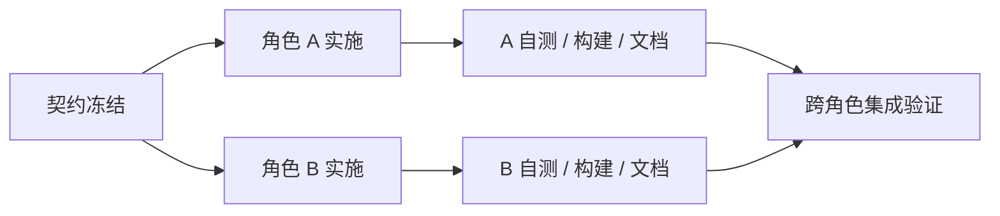
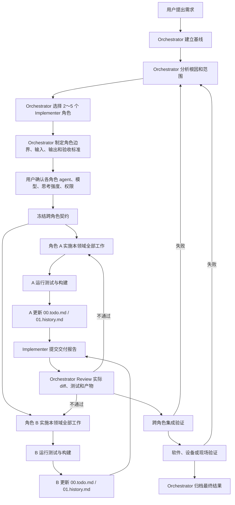

# Orchestrator–Implementer 多角色协同开发架构

> 适用范围：所有代码任务（嵌入式 MCU、上位机、算法、后端、数据库等）
> 核心思想：单一收口 + 领域分工 + 独立验证

## 1. 总体架构

本架构采用「Orchestrator 统一收口 + Implementer 按领域分工」的双层结构：

- **Orchestrator（编排者）**：负责理解需求、建立基线、分析根因、划分 2～5 个 Implementer 角色、制定计划、冻结跨角色接口、定义验收标准、审查实际改动并独立验证。
- **Implementer（实施者）**：按领域角色实施。每个角色负责其领域内从分析、编码、测试、构建到交接的完整工作，不再将同一领域拆成多个过细的执行角色。
- **用户 / 领域专家**：负责提供真实环境信息，并完成现场、设备、业务和最终验收。

三条不可妥协的约束：

1. 所有代码任务必须经过完整闭环：**基线 → 角色划分 → 计划 → 契约确认 → 实施 → 角色文档更新 → Review → 跨角色集成 → 软件验证 → 现场验证 → 文档归档**（低风险单角色任务可走轻量通道，见 3.3）。
2. 任何角色的完成报告、软件测试通过或构建成功，都**不能替代**系统级验证和真实环境验收。
3. 每个角色在报告完成前，**必须**更新 `00.todo.md` 和 `01.history.md`，记录任务状态、修改文件、测试结果、构建产物、未完成项和经验教训。

## 2. 角色定义

### 2.1 Orchestrator

| 职责 | 说明 |
| --- | --- |
| 理解需求 | 将用户描述转化为可执行、可验收的任务定义 |
| 建立基线 | 记录任务开始前的提交号，作为 diff 与回溯的基准 |
| 分析根因与范围 | 定位问题根因，明确改动影响面，避免表面修复 |
| 划分角色 | 选择 2～5 个 Implementer 角色，并划定边界 |
| 制定计划 | 明确各角色的输入、输出、依赖顺序与验收标准 |
| 冻结跨角色接口 | 在实施前锁定协议、数据结构、命令等跨角色契约 |
| 审查实际改动 | Review 真实 diff、测试结果与构建产物，而非只看报告 |
| 独立验证 | 自行复现测试与集成验证，不依赖 Implementer 的自述 |
| 归档结果 | 汇总交付报告、验证记录与遗留项，完成最终归档 |

#### 独立性保证

Orchestrator 同时参与根因分析与计划制定，Review 时容易产生确认偏误。以下四条为硬性要求：

1. **先 diff 后报告**：Review 顺序固定为「读 diff → 跑验证 → 最后看交付报告」，避免被报告措辞锚定。
2. **至少一条自写命令**：独立验证不得完全复用 Implementer 的测试脚本，必须有一条 Orchestrator 自行编写的验证命令或观测手段。
3. **反向假设**：Review 结论中必须写明「如果这个改动是错的，最可能错在哪」，并针对该点做一次检查。
4. **高风险换人复核**：涉及安全、现场设备、不可回滚操作的改动，由未参与实施的实例或第二个角色复核。

### 2.2 Implementer

Implementer 按**完整业务领域**拆分。一个角色负责一个领域的全部相关工作，包括分析、实现、测试、构建和交接；只有跨领域的工作才单独设置角色。

| 角色 | 完整负责范围 |
| --- | --- |
| 领域实现角色 | 某一个核心业务领域的全部实现、测试和调试，例如 MCU、后端、算法或数据库 |
| 用户端角色 | 上位机、桌面端、Web 前端、移动端及其通信和交互逻辑 |

### 2.3 用户 / 领域专家

- 提供真实环境信息（设备状态、现场条件、业务规则）；
- 决定各角色使用的 agent、模型、思考强度与权限；
- 完成现场验证、设备验证、业务验证和最终验收；
- 对 Orchestrator 无法在软件层确认的结论作出判定。

## 3. 角色选择原则

### 3.1 按任务影响面选择角色

并不是每个任务都需要启用全部角色。按任务实际影响面选择 2～5 个角色：

| 任务示例 | 需要的角色 |
| --- | --- |
| 修复上位机枚举 | 仅上位机角色 |
| 修改 MCU 参数协议 | MCU 角色 + 上位机角色 |
| 发动机运行前验收 | 所有相关角色参与，仍由 Orchestrator 统一收口 |

划分原则：

- 按完整业务领域拆分，不按执行步骤拆分；
- 同一领域不再拆成多个过细的执行角色；
- 只有跨领域的工作才单独设置角色；
- 单任务角色数量控制在 2～5 个。

### 3.2 角色依赖与并行

角色划分完成后，Orchestrator 必须同时给出依赖关系，不能按报告顺序串行推进。



编排规则：

| 规则 | 说明 |
| --- | --- |
| 契约先行 | 契约冻结前，任何角色不得开始依赖该契约的实现 |
| 无依赖并行 | 不共享契约、不共享文件的角色并行实施，不排队等待 |
| 契约所有者先交付 | 提供接口的一方先完成交付，消费方在契约冻结后即可独立开发 |
| 集成统一入口 | 所有角色交付完成后才进入集成验证，集成由 Orchestrator 统一执行 |
| 阻塞即上报 | 角色被外部条件阻塞时立即上报，不得静默等待或自行绕过 |

### 3.3 轻量通道

满足以下**全部**条件的任务可走轻量通道：

- 只涉及 1 个角色；
- 改动文件不超过 2 个；
- 不涉及跨角色接口；
- 不涉及设备行为、现场行为或不可回滚操作。

轻量通道流程：`基线 → 实施 → 自测与构建 → 文档更新 → Review → 归档`。

可裁剪：跨角色集成验证、现场验证。

不可裁剪：基线提交、独立验证、`00.todo.md` / `01.history.md` 留痕。

## 4. 执行环境配置

角色划分完成后、实施开始前，由用户决定每个角色使用什么 agent、什么模型、思考强度和权限。Orchestrator 不得自行假定。

| 配置项 | 可选值 | 默认值 | 决定人 |
| --- | --- | --- | --- |
| Agent | Codex、Claude Code、OpenCode、CodeBuddy Code 等 | 无默认，必须由用户指定 | 用户 |
| 模型 | 各 agent 支持的模型 | 该 agent 可用的最强模型 | 用户 |
| 思考强度 | ultra / max / high / medium / low | 最高档（ultra 或 max） | 用户 |
| 权限 | Full access / 受限模式 | Full access | 用户 |

规则：

1. 用户未指定时，Orchestrator 提出建议配置，经用户确认后写入计划，不得静默采用默认值。
2. 不同角色可以配置不同的 agent 与模型，逐角色确认。
3. 配置结果写入实施计划的「执行环境」栏，并在各角色交付报告中注明实际使用的 agent、模型与思考强度。
4. 思考强度默认取该 agent 的最高档；agent 不支持分级时按最高档执行。
5. 权限默认 Full access，但不豁免第 9 节的回退约束与第 10 节的验收要求。

## 5. 标准流程



图中的角色 A / B 代表并行实施的多个领域角色，实际数量按任务确定。Review 不通过时，只让存在问题的角色返工，其余角色的交付保持不变。

### 5.1 阶段说明

| 阶段 | 责任角色 | 关键产出 | 失败去向 |
| --- | --- | --- | --- |
| 需求理解 | 用户 + Orchestrator | 需求描述、约束条件 | — |
| 基线建立 | Orchestrator | 基线提交号 | — |
| 根因与范围分析 | Orchestrator | 根因结论、影响范围清单 | — |
| 角色划分 | Orchestrator | 角色列表、职责边界、依赖关系 | — |
| 执行环境确认 | 用户 | 各角色的 agent、模型、思考强度、权限 | 角色划分 |
| 计划与契约冻结 | Orchestrator | 实施计划、契约清单与版本、验收标准 | — |
| 实施 | Implementer | 代码改动 | 计划阶段 |
| 自测与构建 | Implementer | 测试结果、构建产物、CRC/SHA | 本角色实施 |
| 角色文档更新 | Implementer | 00.todo.md、01.history.md 对应章节 | 本角色实施 |
| 交付报告 | Implementer | 标准格式交付报告 | 本角色实施 |
| Review 与独立验证 | Orchestrator | Review 结论、复现记录、反向假设 | 实施阶段 |
| 跨角色集成验证 | Orchestrator + 相关角色 | 集成测试结果 | 契约确认 / 实施阶段 |
| 软件 / 设备 / 现场验证 | 用户 / 领域专家 | 验收记录 | 根因分析 |
| 最终归档 | Orchestrator | 归档文档与遗留项清单 | — |

## 6. 契约管理与变更

跨角色契约包括：通信协议字段、数据结构、命令码、文件格式、共享配置、产物命名规则。

### 6.1 契约所有权

| 规则 | 说明 |
| --- | --- |
| 唯一所有者 | 每个契约文件只有一个角色拥有写权限，其他角色只读 |
| 显式声明 | 计划阶段列出契约清单，逐项标注所有者与消费方 |
| 版本标记 | 契约冻结时记录版本号或提交号，在各角色交付报告的「接口变化」字段中注明 |

### 6.2 变更流程

实施阶段发现契约有问题时，按以下顺序处理，**禁止私自修改**：

1. 提出方向 Orchestrator 提交变更请求，说明问题、影响范围和替代方案；
2. Orchestrator 判定是否变更，并评估对已实施部分的影响；
3. 变更获批后，由契约所有者修改并更新版本号；
4. Orchestrator 通知所有消费方角色；
5. 每个消费方书面确认已同步，未确认的不得进入集成验证；
6. 变更原因与结论写入 `01.history.md`。

### 6.3 禁止事项

- 实施阶段单方面修改契约文件；
- 以口头约定、聊天记录替代契约文档；
- 消费方按旧版本实现且未在交付报告中声明。

## 7. Implementer 交付报告模板

每个 Implementer 角色完成后，必须输出：

```text
角色：
任务：
基线提交：
修改文件：
接口变化：
测试命令：
测试结果：
构建产物：
CRC/SHA：
未完成项：
需要其他角色处理的事项：
```

字段要求：

| 字段 | 要求 |
| --- | --- |
| 角色 | 本次承担的角色名称 |
| 任务 | 一句话说明任务目标 |
| 基线提交 | 开始工作时的 commit，便于计算真实 diff |
| 修改文件 | 完整文件清单，不得省略 |
| 接口变化 | 跨角色协议、数据结构、命令的变更；无变更写「无」 |
| 测试命令 | 可直接复现的命令 |
| 测试结果 | 通过 / 失败及关键输出摘要 |
| 构建产物 | 产物路径与文件名 |
| CRC/SHA | 产物校验值，用于现场核对 |
| 未完成项 | 明确列出遗留问题，不得隐瞒 |
| 需要其他角色处理的事项 | 交接内容与前置条件 |

## 8. 角色文档要求

每个角色在报告完成前必须更新以下文档：

| 文档 | 必须记录的内容 | 写入方式 |
| --- | --- | --- |
| `00.todo.md` | 任务状态、修改文件、测试结果、构建产物、未完成项 | 按角色分区，固定标题 `## [角色名]`，只修改本角色章节 |
| `01.history.md` | 经验教训 | 按角色分区，追加到本角色章节末尾 |

并发写入约定：

- 多个角色同时工作时，禁止整文件覆盖，只允许编辑自己名下的章节；
- 工具不支持分区编辑时，拆分为 `00.todo.<角色>.md` 与 `01.history.<角色>.md`；
- Orchestrator 在归档阶段合并分文件，并检查是否有遗漏章节。

## 9. 失败与回退路径

流程不只描述顺利路径，任何失败都必须回到明确的阶段，不允许就地打补丁。

| 失败点 | 判定人 | 回退目标 | 处理要求 |
| --- | --- | --- | --- |
| 实施受阻 | Implementer | 计划阶段 | 上报阻塞原因，由 Orchestrator 调整分工或契约 |
| 自测失败 | Implementer | 本角色实施 | 自行修复，不得带缺陷交付 |
| Review 不通过 | Orchestrator | 实施阶段 | 列出具体问题清单，角色逐项返工后重新提交 |
| 集成验证失败 | Orchestrator | 契约确认 / 实施阶段 | 先判定是契约歧义还是实现错误，再决定回退层级 |
| 软件验证失败 | Orchestrator | 根因分析 | 重新确认根因，不得直接改代码 |
| 设备 / 现场验证失败 | 用户 / 领域专家 | 根因分析 | 必须重走根因分析与计划，禁止现场直接打补丁 |

回退原则：

- 回退必须记录原因、影响范围和重新进入的阶段；
- 同一问题回退两次仍未解决，判定为根因分析错误，重新审视需求与范围；
- 现场验证失败是最高优先级信号，说明软件层验证存在盲区，必须补充对应的验证手段。

## 10. 验收边界

以下结论均**不构成**系统验收：

- 角色提交完成报告；
- 软件测试全部通过；
- 构建成功并产出镜像 / 安装包。

只有同时满足以下条件，任务才算闭环：

1. Orchestrator 完成实际 diff 审查与独立验证；
2. 跨角色集成验证通过；
3. 软件验证、设备验证、现场 / 业务验证全部完成；
4. Orchestrator 完成最终归档。

轻量通道任务可豁免第 2 条；单角色任务不涉及设备与现场时，第 3 条以软件验证为准。第 1、4 条不可豁免。
